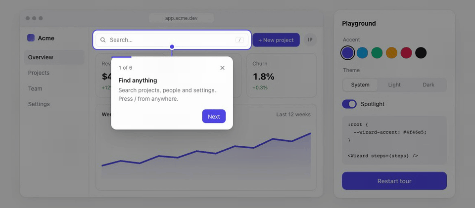

# react-onboarding

Product tours for React. A card points at an element, the rest of the page dims, and the card glides from step to step.

[](https://www.npmjs.com/package/react-onboarding)
[](https://github.com/ilyapasyuk/react-wizard-tour/actions/workflows/ci.yml)
[](https://bundlephobia.com/package/react-onboarding)

**[Live demo and playground →](https://ilyapasyuk.github.io/react-wizard-tour/)**

<picture>
  <source media="(prefers-color-scheme: dark)" srcset="docs/tour-dark.gif" />
  
</picture>

- **Spotlight** dims the page around the target. Clicks still reach the page.
- **Animated steps.** The card and the spotlight glide to the next target in 320 ms; the text crossfades. Reduced motion keeps only fades.
- **Follows its target** on scroll and resize, flips to another side near screen edges, centres itself when the target is missing or hidden.
- **Top layer** through the Popover API: no `z-index` fights with your modals.
- **Keyboard and screen readers:** `←` `→` navigate, `Esc` closes, focus moves into the card and back, the card is a labelled dialog.
- **Themeable** with CSS variables; light and dark built in.
- **Small:** 2.4 KB gzip JS + 2.5 KB gzip CSS, one dependency ([`@floating-ui/react-dom`](https://floating-ui.com)). React 18 and 19, TypeScript types included.

## Install

```sh
npm install react-onboarding
```

## Use

```tsx
import { useRef } from 'react'
import { Wizard, type WizardStep } from 'react-onboarding'
import 'react-onboarding/style.css'

export function App() {
  const saveButton = useRef<HTMLButtonElement>(null)

  const steps: WizardStep[] = [
    { target: '#search', title: 'Search', description: 'Find anything here.' },
    { target: saveButton, title: 'Save', description: <b>Saves a draft.</b>, placement: 'bottom' },
  ]

  return (
    <>
      <input id="search" />
      <button ref={saveButton}>Save</button>
      <Wizard steps={steps} />
    </>
  )
}
```

### Start the tour from a button

```tsx
const [open, setOpen] = useState(false)

<button onClick={() => setOpen(true)}>Show tour</button>
<Wizard steps={steps} open={open} onOpenChange={setOpen} />
```

`onOpenChange(false, reason)` reports why the tour closed: `'close'`, `'escape'` or `'finish'`. Use `'finish'` to remember that the user completed it.

## Props

| Prop             | Type                                            | Default |
| ---------------- | ----------------------------------------------- | ------- |
| `steps`          | `WizardStep[]`                                  | —       |
| `open`           | `boolean` — controlled visibility               |         |
| `defaultOpen`    | `boolean` — initial visibility, uncontrolled    | `true`  |
| `onOpenChange`   | `(open: boolean, reason) => void` — on close    |         |
| `step`           | `number` — controlled zero-based step           |         |
| `defaultStep`    | `number` — initial step, uncontrolled           | `0`     |
| `onStepChange`   | `(step: number) => void`                        |         |
| `labels`         | `{ prev, next, finish, close, counter }`        | English |
| `spotlight`      | `boolean` — dim the page and outline the target | `true`  |
| `scrollToTarget` | `boolean` — scroll each target into view        | `true`  |
| `className`      | `string` — added to the card                    |         |

### `WizardStep`

| Field         | Type                                                | Default   |
| ------------- | --------------------------------------------------- | --------- |
| `target`      | CSS selector or `RefObject<Element>`                | —         |
| `title`       | `ReactNode`                                         | —         |
| `description` | `ReactNode`                                         |           |
| `placement`   | `'top' \| 'right' \| 'bottom' \| 'left'`            | `'right'` |

A step whose target is missing or hidden (`display: none`) shows the card in the centre of the viewport.

### Labels

```tsx
<Wizard
  steps={steps}
  labels={{ prev: 'Назад', next: 'Далее', finish: 'Готово', close: 'Закрыть', counter: (s, t) => `${s} из ${t}` }}
/>
```

## Styling

Set variables on `:root`, or on a class you pass as `className`:

```css
:root {
  --wizard-accent: #e11d48; /* buttons, progress, connector, spotlight ring */
  --wizard-width: 320px;
  --wizard-radius: 12px;
}
```

| Variable | Default |
| --- | --- |
| `--wizard-accent`, `--wizard-accent-fg` | `#4f46e5`, `#fff` |
| `--wizard-bg`, `--wizard-fg`, `--wizard-muted`, `--wizard-border` | light and dark values |
| `--wizard-button-bg`, `--wizard-button-hover` | light and dark values |
| `--wizard-backdrop` | spotlight dimming, 45% black / 65% in dark |
| `--wizard-radius`, `--wizard-width`, `--wizard-shadow` | `14px`, `300px`, layered shadow |
| `--wizard-color-scheme` | `light dark` — follows the OS; set `light` or `dark` to force |

The card carries `data-side="top|right|bottom|left|center"` and `data-moving` while it travels between steps.

## Migrating from 1.x

2.0 breaks the API. The 1.x bundle crashes on React 19, so upgrade before moving to React 19.

| 1.x                                         | 2.0                                                        |
| ------------------------------------------- | ---------------------------------------------------------- |
| `import Wizard from 'react-onboarding'`     | `import { Wizard } from 'react-onboarding'`                |
| CSS injected automatically                  | `import 'react-onboarding/style.css'` once                 |
| `rule={[{ elementId: 'save', ... }]}`       | `steps={[{ target: '#save', ... }]}`                       |
| `title` rendered as HTML                    | `title` is a `ReactNode`; pass JSX instead of HTML strings |
| `isShow`                                    | `open` + `onOpenChange`, or `defaultOpen`                  |
| `prevButtonTitle`, `nextButtonTitle`, `closeButtonTitle` | `labels={{ prev, next, close }}`              |
| `closeButtonElement`                        | `labels={{ close: <Icon /> }}`                             |
| `pinColor`, `lineColor`                     | CSS variable `--wizard-accent`                             |
| `isScrollToElement` (default `false`)       | `scrollToTarget` (default `true`)                          |
| UMD and CommonJS builds                     | ES module only; `require()` works on Node 20.19+           |

## Develop

```sh
npm install
npm run dev            # demo and playground on http://localhost:3000
npm test               # unit tests in jsdom + positioning tests in Chromium
npm run lint           # Biome
npm run mutation       # Stryker
```

The browser tests need Chromium once: `npx playwright install chromium-headless-shell`.

## License

MIT
